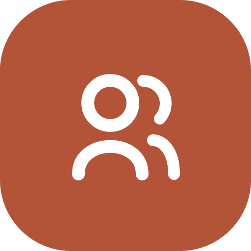

<h1 align="left">
  
  Together We
</h1>

**Together We** is a community service and social development platform that connects people through meaningful local events and initiatives. Users can explore upcoming events, participate in community activities, create their own initiatives, and manage the events they organize.

## 🌐 Live Website

[Visit Together We](https://togetherwe-connect.vercel.app/)

## 🛠️ Technologies Used

### Frontend
- Next.js (App Router)
- React
- TypeScript
- Tailwind CSS
- shadcn/ui
- Base UI
- Lucide React
- React Hook Form
- Zod
- Sonner

### Authentication & Authorization
- Better Auth
- MongoDB Adapter
- JWT

### Backend
- Express.js
- MongoDB
- JavaScript

## ✨ Key Features

- **Upcoming Events:** Explore upcoming community service events and initiatives.
- **Event Details:** View event descriptions, locations, dates, organizers, and participant counts.
- **User Authentication:** Register and log in using email and password or Google authentication.
- **Create Events:** Organize new community events by providing event details.
- **Join Events:** Participate in events that interest you.
- **Joined Events:** View all the events you have joined.
- **Manage Events:** Edit or delete events you have created.
- **Protected Routes:** Restrict private pages and verify user authorization.
- **Form Validation:** Validate user input with React Hook Form and Zod.
- **Loading Skeletons & Error Handling:** Improve the user experience during loading and unexpected errors.
- **Dark & Light Themes:** Switch between light and dark modes.
- **Responsive Design:** Enjoy a consistent experience across mobile, tablet, and desktop devices.